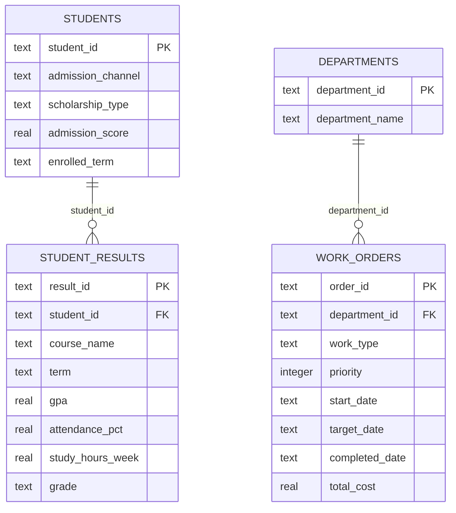

# 03 — Data Model, Definitions and Quality

## Provenance: two distinct evidence layers

**Layer A — Original coursework:** the submitted MIS781 report, three Power BI `.pbix` files and original dashboard screenshots. The original report describes data drawn from public sources and/or GenAI-generated material. Full original fact tables are not separately available in the supplied source files, so original dashboard measures cannot currently be independently reconciled.

**Layer B — Portfolio reproducibility:** an entirely **new synthetic demonstration**, with 50 department ID/name reference records exported from the available workbook after removing department-head names. Student and work-order facts are newly generated in code and **must never be confused with Layer A**.

## Conceptual demo model

The **student** grain is not the **course-result** grain; total students require `COUNT(DISTINCT student_id)` when multiple results per student are possible. Maintenance totals must be aggregated at **one row per order** before joining departmental attributes.

## Metric dictionary

| KPI | Definition / denominator | Important caveat |
|---|---|---|
| Average GPA | `AVG(student_results.gpa)` for eligible course records | **Never `SUM(GPA)`** as a course performance metric. Clarify whether the business requires student-weighted or course-record-weighted GPA. |
| Pass rate | Eligible course results with grade other than F / eligible course results | A pass definition and grade mapping must be approved; current demo uses F as fail. |
| Average attendance | Mean percentage across eligible results | Missing values must not silently become zero. |
| Total maintenance cost | `SUM(total_cost)` at order grain | Cost alone is not a service-quality or profitability measure. |
| Overdue work order rate | Completed late **or** still open past target / all work orders at 2026-09-01 snapshot | An overdue definition depends on reporting date, completion fields and exclusions. |
| Mean priority | `AVG(priority)` within work type | Prefer distribution/count by priority for operational triage; ordinal scale averaging is only descriptive. |
| Observed current-risk rate | Post-term results with GPA < 2.0 **or** attendance < 65% / results | Illustrative rule; **not** a validated early-warning or admissions predictive model. |
| Scholarship comparison | `AVG(gpa)` / `AVG(attendance_pct)` by scholarship type | An association, **not** an identified scholarship effect. |

## Quality controls built into the demonstration

| Control | Automated? | Stop release when... |
|---|---|---|
| Unique primary keys | Yes (SQLite constraints/tests) | Duplicate `student_id`, `result_id` or `order_id` |
| Referential integrity | Yes | Student or department foreign keys do not match |
| Valid GPA / attendance ranges | Yes | GPA outside 0–4 or attendance outside 0–100 |
| Valid priority / satisfaction | Yes | Priority outside 1–5 or non-null satisfaction outside 1–5 |
| Chronology | Yes | Completion date predates the work-order start |
| Refresh and snapshot metadata | Documented | Actual production freshness SLA not yet supplied |
| Population/rate reconciliation | Documented; partial code tests | Before production, add source-to-dashboard count and missingness checks |

Run: `python demo/scripts/generate_demo.py`, then `python demo/scripts/analyse.py`, then `python -m unittest discover -s demo/tests -v` from the repository root.

## Why the original dashboard visual metadata matters

Inspection of the uploaded `.pbix` report layouts identified **aggregation/title questions requiring review**:

- Faculty course GPA visual references `Sum(...Cuml_GPA)` even though the report labels the comparison **average GPA**.
- Facilities report uses `Sum(...SatisfactionScore)` in a matrix described as **average satisfaction**.
- Facilities scatterplot is titled **Total Cost vs Delay Days**, but its x-position appears bound to `Duration`, not `Delay_Days`.
- Facilities priority radar uses `Sum(Priority)` while the report discusses average priority.

These are audit findings from visual configurations, **not** claims that the source data has already been repaired or the published Power BI files corrected. Remediation requires confirming intended measure definitions, fixing visual aggregations and reconciling totals inside Power BI.

[Next → Analytical findings](04-analytical-findings.md)
